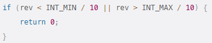
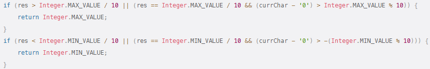

# leetcode

Improve algorithm skills

## 刷题计划

> [!IMPORTANT]
> 每天刷三道算法题：力扣每日一题+题库按顺序2题。要写一下自己的解题心得。必要的时候可以计时。

### 9月9日

#### [3871. 统计范围内的逗号 II](https://leetcode.cn/problems/count-commas-in-range-ii/)

前一天做了他的简单版，不过用的是面向测试用例解答，然后看题解详细说明了当测试用例变大的时候应该怎么做。今天就刚好把昨天看到的题解用代码敲出来了。用到的想法是按照数的位数进行分段讨论。

$\\color{red}{\text{时间：很快。但是不是独立思考出来的}}$

#### [1. 两数之和](https://leetcode.cn/problems/two-sum/)

暴力做法是遍历两遍，找到所有二元对的组合判断和是否为目标值$`target`$。改进做法使用哈希表，在遍历之前先询问哈希表中是否存在和当前遍历的数配对的情况，然后再将该数存入哈希表中。至于为什么要先找再存，是因为不能使用两次相同的元素，如果可以使用相同的元素，就要先存再找了。

$\\color{red}{\text{时间：1min30s。独立思考}}$

#### [2. 两数相加](https://leetcode.cn/problems/add-two-numbers/)

这道题是链表的两数之和，不过它简单一点，已经帮我们把数逆序了。我们要做的是按照高精度加法的思路，依次遍历每个数位和当前进位，得到该位的总和以及下一个进位。不断循环该过程，最后注意处理如果最后进位不为0的情况，要再追加一个1。

$\\color{red}{\text{时间：7min36s。独立思考}}$

### 9月10日

#### [2265. 统计值等于子树平均值的节点数](https://leetcode.cn/problems/count-nodes-equal-to-average-of-subtree/)

这道题的思路是计算子树的和以及子树的大小，我卡在了如何记录两个数据。我的想法是$`dfs`$两次,，但是$`dfs`$一次后对应的树改变了，无法进行第二次。然后看了题解，可以在返回值里做文章，返回一个$`pair`$对记录子树的总和以及子树的大小。豁然开朗，立马敲下代码，写出来了。

$\\color{red}{\text{时间：30min左右。看了一点题解}}$

#### [3. 无重复字符的最长子串](https://leetcode.cn/problems/longest-substring-without-repeating-characters/)

这道题使用的是滑动窗口和哈希表解法，左端点固定，不断扩展右端点。如果中途右端点不满足要求了，就尝试移动左端点使其重新满足要求。属于不定长滑动窗口类型。

$\\color{red}{\text{时间：2min41s。独立思考}}$

#### [4. 寻找两个正序数组的中位数](https://leetcode.cn/problems/median-of-two-sorted-arrays/)

**我的第一想法是按照归并排序的思路，先合并两个有序链表存在一个新数组中，然后就可以求这个新数组的中位数了。难点是归并排序。但是该时间复杂度是$`O(m+n)`$，空间复杂度$`O(m+n)`$，不符合题目$`O(log(m+n))`$的要求。第二个想法是不用真的保存在一个数组中，而是每次遍历都排除一个答案，空间复杂度可以降到$`O(1)`$。另一个想法是分治，每次比较两个数组的中位数，排除其中较小元素左边的所有数，但是存在问题，可能排除了过多的元素。看了题解发现每次比较的是数组$`（k/2-1）`$位置上的数，并排除$`（k/2-1）`$个数，然后更新k。还有第四种解法，二分查找较短数组的分割点，使两个数组的个数相同，如果左边数组的最大值$` \le `$右边数组的最小值，则分割成立，返回答案。**

$\\color{red}{\text{时间：第二个想法29min39s，独立思考。第一个想法9min，独立思考。第三个想法没写出来。第四种解法自己没想到，看了题解才懂}}$

### 9月11日

#### [3483. 不同三位偶数的数目](https://leetcode.cn/problems/unique-3-digit-even-numbers/)

这道题我采用的暴力的做法，三重循环枚举每一个数位，然后判断最后形成的是否是三位数，是否是偶数。如果是把它存在$`set`$中，最后返回$`set`$的大小即可。

$\\color{red}{\text{时间：4min29s。独立思考}}$

#### [5. 最长回文子串](https://leetcode.cn/problems/longest-palindromic-substring/)

**这道题我的想法是让每一个位置作为回文串的中心，向左右两边遍历。有两种情况，一种是中心只有一个，另一种是中心有两个。可以遍历两次分别进行讨论。看题解发现这种方法叫做中心扩展法。然后还有一种叫做动态规划的解法，用一个数组$`dp[i][j]`$记录i到j是否是回文串来避免重复计算。具体做法是可以枚举左右端点，如果$`s[l]==s[r]\&\&(r-l<=2||dp[l+1][r-1])`$，则$`dp[i][j]`$为true。注意这里要先枚举右端点再枚举左端点。因为$`dp[i][j]`$的确定要依靠$`dp[i+1][j-1]`$**

做了几题类似的题目：
+ [516. 最长回文子序列](https://leetcode.cn/problems/longest-palindromic-subsequence/)
+ [647. 回文子串](https://leetcode.cn/problems/palindromic-substrings/)

$\\color{red}{\text{时间：中心扩展法5min左右。独立思考}}$

#### [6. Z 字形变换](https://leetcode.cn/problems/zigzag-conversion/)

这道题的想法是利用周期来做，计算出每个字符所在的行和列，然后存在一个新二维数组中，最后按行遍历这个二维数组。难点是找到计算行和列的表达式。看了题解，发现有一个更好的办法是设置一个标记记录当前的移动方向是向上还是向下，来判断当前字符位于第几行。

$\\color{red}{\text{时间：代码很快写出来了，debug用了很久。独立思考}}$

### 9月12日

#### [3414. 不重叠区间的最大得分](https://leetcode.cn/problems/maximum-score-of-non-overlapping-intervals/)

**刚开始写这道题没一点思路，不知道如何处理。然后看题解学习。这道题的前身是没有最多4个的限制,做法是先按照结束时间排序，然后动态规划遍历，如果不选第i个，$`dp[i]=dp[i-1]`$，如果选第i个，$`dp[i]=dp[j]+profit[i]`$,其中j是满足$`end[j]{<}start[i]`$条件中最大的数（可以用二分搜索，因为已经按结束时间排好序了）。然后这道题多了一个限制，所以在动态规划时多加一维度，如果不选第i个，$`dp[i][j]=dp[i-1][j]`$;如果选第i个，$`dp[i][j]=dp[k][j-1]+profit[i]`$，其中k是满足$`end[k] \lt start[i]`$条件中最大的数（可以用二分搜索，因为已经按结束时间排好序了）。这道题还有一个难点是要返回最小字典序的答案，所以在更新最大值时要顺便更新答案的组成。**
还做了几题相似题目:

+ [1235. 规划兼职工作](https://leetcode.cn/problems/maximum-profit-in-job-scheduling/)，[2008. 出租车的最大盈利](https://leetcode.cn/problems/maximum-earnings-from-taxi/):无限制;
+ [1751. 最多可以参加的会议数目 II](https://leetcode.cn/problems/maximum-number-of-events-that-can-be-attended-ii/):限制k个;
+ [2054. 两个最好的不重叠活动](https://leetcode.cn/problems/two-best-non-overlapping-events/):限制k=2;
+ [3414. 不重叠区间的最大得分](https://leetcode.cn/problems/maximum-score-of-non-overlapping-intervals/)（本题）:限制k=4且要输出字典序最小的方案。

$\\color{red}{\text{时间：3h左右}}$

#### [7. 整数反转](https://leetcode.cn/problems/reverse-integer/)

不断循环取模，得到反转整数。注意先判断是否是负数，再用$`abs`$函数转化为正数进行求解。要先判断是否越界再进行运算。注意判断溢出如果不能使用$`long~long`$的话使用如下方法：

$\\color{red}{\text{时间：5min35s}}$

#### [8. 字符串转换整数 (atoi)](https://leetcode.cn/problems/string-to-integer-atoi/)

遇到空格，跳过；遇到正号或者负号或者数字，循环看下一个字符直到不是数字为止，退出；遇到其他字符，退出。不能使用$`long~long`$的话先按照下面方法判断是否越界，再进行运算：

$\\color{red}{\text{时间：7min18s}}$

### 9月14日

#### [836. 矩形重叠](https://leetcode.cn/problems/rectangle-overlap/)

这道题可以把它转化为一维形式，只要横坐标严格相交并且纵坐标严格相交，则两个矩形相交。我判断两段线段相交的方法是分类讨论。分别判断左右两端点是否在落在另一个线段中，另一个线段也同样判断。看了题解后发现，判断两个区间是否有交集：正向思维就是我的想法，逆向思维是判断所有不相交的情况，A在B前或者A在B后。还有一种优化的思路，判断$`max(l_1,l_2)<min(r_1,r2)`$即可。

$\\color{red}{\text{时间：24min46s。独立思考}}$

#### [9. 回文数](https://leetcode.cn/problems/palindrome-number/)

这道题和[7. 整数反转](https://leetcode.cn/problems/reverse-integer/)类似，思路是分情况讨论，负数因为有负号不可能是回文数，然后判断正数，如果是回文数的话，反转后应该等于本身，判断溢出的方法是在运算之前判断$`res`$是否大于$`INT_MAX/10`$。看了题解后发现有更高效的方法，即只反转一半数字来避免溢出，只要$`x`$还大于$`res`$就继续反转，最终比较剩余的$`x`$是否等于$`res`$（长度为偶数）或者等于$`res/10`$（长度为奇数）即可

$\\color{red}{\text{时间：3min04s。独立思考}}$

#### [10. 正则表达式匹配](https://leetcode.cn/problems/regular-expression-matching/)

**没什么思路，看了题解。发现是动态规划，$`dp[i][j]`$代表字符串s的前i个字符和p的前j个字符能否匹配。当$`p[j-1]=='*'`$时，$`dp[i][j]=dp[i][j-2] || (dp[i-1][j] \&\& match(s[i-1],p[j-2]))`$。当$`p[j-1]!='*'`$时，$`dp[i][j]=dp[i-1][j-1]\&\&match(s[i-1],p[j-1])`$。初始化如下：$`dp[0][0]=true;dp[0][j]=dp[0][j-2]\&\&p[j-1]='*'`$。这题的难点主要是转移方程不好想，导致无从下手。**

$\\color{red}{\text{时间：43min。看了题解}}$

### 9月15日

#### [2472. 不重叠回文子字符串的最大数目](https://leetcode.cn/problems/maximum-number-of-non-overlapping-palindrome-substrings/)

**一开始没思路，看了题解后发现很简单，划分型$`dp`$/贪心。$`dp[i]`$表示以$`s[i-1]`$结尾的能划分的回文子字符串最大数目。如果不选$`s[i-1]`$，则$`dp[i]=dp[i-1]`$，如果选$`s[i-1]`$，则要求$`[i-k,i-1]`$或者是$`[i-k-1,i-1]`$是回文串，此时$`dp[i]=max(dp[L])+1`$，其中$`L`$为$`i-k`$或者是$`i-k-1`$。 另一种方法是贪心，第一个回文子串的右端点越小越好。另外还做了灵神题单中划分型$`dp`$的相关题目：**

+ [132. 分割回文串 II](https://leetcode.cn/problems/palindrome-partitioning-ii/)
+ [2707 字符串中的额外数组](https://leetcode.cn/problems/extra-characters-in-a-string/)
+ [3196 最大化子数组的总成本](https://leetcode.cn/problems/extra-characters-in-a-string/)
+ [2767 将字符串分割为最少的美丽子字符串](https://leetcode.cn/problems/partition-string-into-minimum-beautiful-substrings/)

$\\color{red}{\text{时间：dp用了16min。看了题解}}$

#### [11. 盛最多水的容器](https://leetcode.cn/problems/container-with-most-water/)

**这道题我一开始的想法是找左边的最大值和右边的最大值位置，然后结果是他们两个之间的较小值乘以他们的距离。但是这样忽略了一个问题：不一定是在最大值位置上能盛的水最多，因为他们的距离不一定是最远的。看了题解，发现用的是双指针的做法，开始时双指针指在数组的左右两端，每次移动较短的那根直到两指针相遇即可。**

$\\color{red}{\text{时间：1min49s。看了题解}}$

#### [12. 整数转罗马数字](https://leetcode.cn/problems/integer-to-roman/)

我的想法是将每个可能用到的数字存在一个$`map`$，然后从大到小遍历这个$`map`$得到最终的答案。看了题解发现有别的做法，根据千位，百位，十位，个位上的数字来做，更巧妙一点。

$\\color{red}{\text{时间：12min53s。独立思考}}$

### 9月16日

#### [1621. 大小为 K 的不重叠线段的数目](https://leetcode.cn/problems/number-of-sets-of-k-non-overlapping-line-segments/)

使用动态规划，$`dp[i][j]`$表示到$`x=i-1`$时，已经有$`j`$个线段的方案数。如果最后一个线段的右端点不是$`j`$，则$`dp[i][j]=dp[i-1][j]`$，如果最后一个线段的右端点是$`j`$，则对于$`\forall p \in [0,j)`$，都有最后一个线段在$`[p,j]`$，方案数为 $`\sum_{p=0}^{j-1} dp[i-1][p]`$。此时可以用前缀和优化，边计算值边计算前缀和。

$\\color{red}{\text{时间：想了很久。独立思考做出来了}}$

#### [13. 罗马数字转整数](https://leetcode.cn/problems/roman-to-integer/)

根据罗马数字的书写规则，当前字符所代表的数字比下一个字符更小时，用下一个字符减去当前字符。否则直接加上当前字符。

$\\color{red}{\text{时间：4min46s。独立思考}}$

#### [14. 最长公共前缀](https://leetcode.cn/problems/longest-common-prefix/)

这道题的思路是依次比较每个字符串和第一个字符串的前缀，如果超出了某个字符串的长度或是匹配到不相等就直接返回答案。如果最终没有返回答案，说明第一个字符串就是答案。第二种方法是字典树，通过构建字典树，然后从头开始遍历，如果该节点只有一个孩子且该节点不是结束字符，继续向下遍历，否则直接返回答案。

$\\color{red}{\text{时间：做的很快。独立思考}}$

### 9月17日

#### [1477. 找两个和为目标值且不重叠的子数组](https://leetcode.cn/problems/find-two-non-overlapping-sub-arrays-each-with-target-sum/)

**这道题的思路是前后缀分解。用$`pre[i]`$表示在$`i`$之前结束且和为$`k`$的最小长度。$`suf[i]`$表示在$`i`$开始或在$`i`$之后开始（反转一下就是以在$`i`$结束或在$`i`$之前结束）且和为$`k`$的最小长度。两个数组都可以用滑动窗口计算得到，最后的结果是$`min(pre[i]+suf[i])`$。$`pre[i]`$正序滑动窗口遍历，$`suf[i]`$逆序滑动窗口遍历。**

$\\color{red}{\text{时间：做了比较久。看了一点提示}}$

#### [15. 三数之和](https://leetcode.cn/problems/3sum/)

这道题的思路是双指针，排序之后固定第一个数，双指针指向第二个数和第三个数。如果三数之和等于$`target`$就加入结果中；如果三数之和小于$`target`$，左指针就右移；如果三数之和大于$`target`$，右指针就左移。一个关键的问题是去重问题，如果$`nums[i]==nums[i-1]`$，说明该数字重复应该跳过。当三数之和等于$`target`$时，$`nums[l]==nums[l-1]`$或者$`nums[r]==num[r+1]`$都会导致重复，应该跳过。

$\\color{red}{\text{时间：做的很快。去重部分看了一下题解}}$

#### [16. 最接近的三数之和](https://leetcode.cn/problems/3sum-closest/)

这道题和15题类似也是双指针。要维护一个数$`t=abs(nums[i]+nums[l]+nums[r]-target)`$。排序之后固定第一个数，计算$`t`$并更新答案。如果$`t==0`$，可以直接返回；如果$`nums[i]+nums[l]+nums[r]\gt target`$，右指针左移，如果$`nums[i]+nums[l]+nums[r]\lt target`$，左指针右移。最后返回答案

$\\color{red}{\text{时间：做的很快。独立思考}}$

### 9月18日

#### [1520. 最多的不重叠子字符串](https://leetcode.cn/problems/maximum-number-of-non-overlapping-substrings/)

**这道题首先要计算合法区间。先记录每个字符的起始位置和结束位置。然后对这些区间进行扩展，区间内部包含字符的起始及结束位置也要包含在里面，新扩展区间每个字符的起始和结束位置也要包含在里面。然后问题变成了从这些区间中，最多可以选多少个互不重叠的区间。按照右端点进行排序，不断记录新的右端点。另一种扩展区间的做法是有向图建模，如果$`a`$的区间中包含别的字符$`b`$，那么连一条从$`a`$到$`b`$的有向边。建模后，如果字串要包含第$`i`$个小写字母，就$`dfs`$这个有向图，所有能访问到的点的对应区间的并集，即为最终字串的下标区间。**

$\\color{red}{\text{时间：做了很久。扩展区间部分看了一下题解。}}$

#### [17. 电话号码的字母组合](https://leetcode.cn/problems/letter-combinations-of-a-phone-number/)

这道题是经典的回溯题，从第一个字符开始选择可能的字符，递归的选择下一个字符即能得到答案。可以用一个哈希表$`unordered\_map<int,string>`$存储数字对应的字母。

$\\color{red}{\text{时间：做的很快。独立思考}}$

#### [18. 四数之和](https://leetcode.cn/problems/4sum/)

这道题和三数之和特别类似。也是使用双指针。排序后固定第一个数和第二个数，双指针指向第三个数和第四个数。如果四数之和等于$`target`$就加入到结果中；如果四数之和小于$`target`$，左指针右移；如果四数之和大于$`target`$，右指针就左移。至于去重问题，如果$`i>0\&\&nums[i]==nums[i-1]`$，说明该数字重复应该跳过；如果$`j>i+1\&\&nums[j]==nums[j-1]`$，说明该数字重复应该跳过。当四数之和等于$`target`$时，$`nums[l]==nums[l-1]`$或者$`nums[r]==num[r+1]`$都会导致重复，都应该跳过。

$\\color{red}{\text{时间：15min。独立思考}}$

### 9月20日

#### [3498. 字符串的反转度](https://leetcode.cn/problems/reverse-degree-of-a-string/)

简单题。遍历每个字符，反转字母表的位置根据$`26-s[i]+'a'`$求，字符串的位置根据$`i+1`$求。最大结果$`26 \times 1000 \times 1000`$，未超过$`int`$。

$\\color{red}{\text{时间：1min33s。独立思考}}$

#### [21. 合并两个有序链表](https://leetcode.cn/problems/merge-two-sorted-lists/)

和合并两个有序数组类似，使用双指针，比较两个指针所在位置的大小。每次将较小的加入到结果中并移动它的指针。如果最后有个链表有剩余，把它们全部加入到结果中。看了题解发现有第二种方法，使用递归。如果$`list1[0] \lt list2[0]`$，最终是$`list1[0]+merge(list1[1:],list2)`$，其他情况则是$`list2[0]+merge(list1,list2[1:])`$。

$\\color{red}{\text{时间：第一种方法2min35s。独立思考}}$

#### [22. 括号生成](https://leetcode.cn/problems/generate-parentheses/)

这道题是回溯经典题目。具体的做法是在回溯过程中传递两个参数记录左括号和右括号的剩余数量$`cnt1`$和$`cnt2`$，只有当$`cnt1 \gt 0`$时，才能用左括号；只有当$`cnt2 \gt cnt1`$时，才能用右括号。最终如果$`cnt2==0`$就将其放入到结果中。

$\\color{red}{\text{时间：15min41s。结束条件看了一下题解}}$

### 9月21日

#### [3524. 求出数组的 X 值 I](https://leetcode.cn/problems/find-x-value-of-array-i/)

**这道题使用的是动态规划，定义$`dp[i][r]`$表示以索引$`nums[i-1]`$结尾且乘积模$`k`$等于$`r`$的子数组个数。从$`0`$到$`k-1`$枚举以$`nums[i-2]`$结尾的余数s，如果$`s*nums[i-1]\%k==r`$，$`dp[i][r]+=dp[i-1][s]`$。如果$`nums[i-1]\%k == r`$，则$`dp[i][r]++`$。最终统计$`res[k]= \sum_{1 \le i \le n} dp[i][k]`$。还可以用刷表法，在动态规划中，根据转移来源计算状态叫查表法，用当前状态更新其他状态叫刷表法。刷表法的意思是使用$`dp[i][r]`$的值可以贡献给$`dp[i+1][r \times (nums[i]\%k)\%k]`$。**

$\\color{red}{\text{时间：写了很久，看了一点提示。}}$

#### [23. 合并 K 个升序链表](https://leetcode.cn/problems/merge-k-sorted-lists/)

这道题最小堆的算法，先把头节点存入最小堆中，每次取最小的那个，如果它的$`next`$不为空，继续把它插入到堆中。另一种方法是分治法，把$`lists`$一分为二，先合并前一半的链表，再合并后一半的链表，然后把这两个链表合并成最终的链表。再另一种方法是迭代法，先两两合并，再四四合并，依次类推，直到所有链表都合并了。

$\\color{red}{\text{时间：最小堆10min左右。独立思考}}$

#### [24. 两两交换链表中的节点](https://leetcode.cn/problems/swap-nodes-in-pairs/)

这道题就是多次交换链表的两个元素，掌握了单词交换就能类推到整个链表。首先要记录当前指针$`cur`$，前一个指针$`pre`$，后一个指针$`nex`$。要交换当前指针和下一个指针的方法是：$`pre \rightarrow next=nex;nex \rightarrow next=cur;cur \rightarrow next=nex \rightarrow next;`$。然后令$`pre=cur;cur=cur \rightarrow next;nex=cur \rightarrow next;`$，继续下一个循环。另一种方法是递归，先交换$`nex`$为头节点的链表，然后把$`pre`$指向递归返回的链表头，然后把$`cur`$指向$`pre`$，最后返回$`cur`$。

$\\color{red}{\text{时间：5min39s。独立思考}}$

### 9月22日

#### [3525. 求出数组的 X 值 II](https://leetcode.cn/problems/find-x-value-of-array-ii/)

> [!WARNING]
> 待做

这道题和昨天的题区别是他要支持单点修改，且只能删除后缀。暴力做法是每次修改后统计所有的从 $`start`$ 开始的后缀乘积 $`mod k`$ 余数为 $`x`$ 的个数。但是这样的复杂度是 $`n \times q`$ ，会超时。需要使用线段树进行优化，后续有能力了可以再回过头来解决这道题。

$\\color{red}{\text{没有写出来}}$

#### [25. K 个一组翻转链表](https://leetcode.cn/problems/reverse-nodes-in-k-group/)

这道题首先要掌握反转整个链表的方法。定义三个指针$`pre=nullptr,cur=head,nex=cur \rightarrow next`$。遍历$`cur`$，令$`cur \rightarrow next=pre;pre=cur;cur=nex;`$，即可反转整个链表，最后$`pre`$指针和$`head`$指针分别是反转后链表的头指针和尾指针。$`k`$个一组反转要记录的是$`pre,head,nex`$，其中$`pre`$是第一个数的前一个，$`head`$是第一个数，$`nex`$是第$`k`$个数的后一个。先断开连接，然后调用反转整个链表的方法得到反转后的链表头尾指针，让$`pre`$指向反转后的头节点，然后令$`pre`$等于尾节点，$`head=nex`$，继续新一轮的循环。

$\\color{red}{\text{时间：写了很久。独立思考}}$

#### [26. 删除有序数组中的重复项](https://leetcode.cn/problems/remove-duplicates-from-sorted-array/)

左指针$`left`$指向去重后的最后一个元素，右指针$`right`$指向要处理的元素，如果$`nums[right]==nums[right-1]`$，忽略它；否则令$`nums[left++]=nums[right]`$。最后返回$`left`$即为去重后的个数

$\\color{red}{\text{时间：2min46s。独立思考}}$

### 9月23日

#### [1658. 将 x 减到 0 的最小操作数](https://leetcode.cn/problems/minimum-operations-to-reduce-x-to-zero/)

这道题的大意是让不重叠的前缀+后缀的和$`==x`$，且它们的个数最少。我的想法是因为都是正数，后缀和是单调递增的，可以用哈希表来存储位置$`i`$的后缀。而遍历时，正序遍历的同时计算前缀，查找哈希表中有没有目标值且其位置应该大于当前位置，有的话就可以更新答案。看了题解发现可以用逆向思维，前缀+后缀的和$`==x`$，等价于剩下的子数组$`==sum-x`$。所以题目变成了和为$`sum-x`$的最长子数组，因为没有负数，所以可以用滑动窗口解决，（有负数的话可以使用哈希表）

$\\color{red}{\text{时间：有想法了很快想出来了。独立思考}}$

#### [27. 移除元素](https://leetcode.cn/problems/remove-element/)

和[26. 删除有序数组中的重复项](https://leetcode.cn/problems/remove-duplicates-from-sorted-array/)类似，做指针$`left`$指向移除后的最后一个元素，右指针$`right`$指向要处理的元素，如果$`nums[right]==val`$，忽略它；否则令$`nums[left++]==nums[i]`$。最后返回$`left`$即为移除后的个数

$\\color{red}{\text{时间：很快。独立思考}}$

#### [28. 找出字符串中第一个匹配项的下标](https://leetcode.cn/problems/find-the-index-of-the-first-occurrence-in-a-string/)

经典$`KMP`$算法，可以分为两步：求解前缀函数（$`next`$数组）+匹配。匹配过程除了用类似$`BF`$算法的回溯过程求，还可以将模式串+”#“+文本串的方式求解合并后的$`next`$数组，最后如果$`next`$数组的值等于模式串的长度即视为匹配成功。

$\\color{red}{\text{时间：很快。看了OI WIKI的KMP算法部分}}$

### 9月24日

#### [3550. 数位和等于下标的最小下标](https://leetcode.cn/problems/smallest-index-with-digit-sum-equal-to-index/)

依次判断数组中每个元素的数位和是否等于下标，如果等于直接返回结果。否则返回$`-1`$。

$\\color{red}{\text{时间：1min03s。独立思考}}$

#### [29. 两数相除](https://leetcode.cn/problems/divide-two-integers/)

因为不能使用$`long`$，乘法，除法和取余运算。这道题主要参考快速幂的方法，用加法快速得到乘法结果。然后使用二分法不断寻找符合条件的答案。注意要将所有的正数转化为负数，因为负数的表示范围更大，$`INT\_MIN`$没有对应的正数。要特判被除数是$`INT\_MIN`$，且除数是$`1`$的情况。

$\\color{red}{\text{时间：调试了很久。看了题解}}$

#### [30. 串联所有单词的子串](https://leetcode.cn/problems/substring-with-concatenation-of-all-words/)

**这道题我的想法是用哈希表记录$`words`$中所有单词的个数，然后遍历$`s`$中长度为$`m \times n`$的子字符串，将子字符串均分，也用哈希表记录其中的单词个数，判断和$`words`$的哈希表相不相等，如果相等就把它加入结果之中。看了题解之后发现可以用滑动窗口，根据第一个单词的起始位置不同，做不同的滑动窗口，最多要做$`wordlen`$次滑窗。每次定长滑窗有三步：枚举进入窗口的单词，把它的出现次数加一，可以用一个数字来记录过多的单词个数。更新答案，如果过多的单词个数等于$`0`$，把它加入答案。窗口最左边的单词离开窗口，减少其出现次数，如果符合要求了，就把过多变成符合要求。**

做了几道类似的题目：

+ [438. 找到字符串中所有字母异位词](https://leetcode.cn/problems/find-all-anagrams-in-a-string/)
+ [567. 字符串的排列](https://leetcode.cn/problems/permutation-in-string/)

$\\color{red}{\text{时间：我的想法做的很快。独立思考。滑窗方法看了一下题解}}$

### 9月28日

#### [1614. 括号的最大嵌套深度](https://leetcode.cn/problems/maximum-nesting-depth-of-the-parentheses/)

因为题目数据保证都是有效的括号字符串，所以遇到左括号的时候入栈顺便更新答案；遇到右括号的时候将栈顶元素出栈。

$\\color{red}{\text{时间：1min39s，独立思考}}$

#### [31. 下一个排列](https://leetcode.cn/problems/next-permutation/)

从右到左找到第一个$`nums[i] \lt nums[i+1]`$的位置$`i`$,然后从这个位置出发向右找到最后一个大于$`nums[i]`$的位置$`j`$。最后交换$`nums[i]`$和$`nums[j]`$，并将$`nums[i+1:-1]`$排序得到最终答案

$\\color{red}{\text{时间：思路想了很久，一直根据调试来改正自己的想法，独立思考}}$

#### [32. 最长有效括号](https://leetcode.cn/problems/longest-valid-parentheses/)

**这道题的关键点是栈中应该存什么。正确解答是应该存放不能被匹配的位置。当遇到左括号时，肯定不能匹配，存入栈中；当遇到右括号时，首先查看栈顶是否是左括号，是的话将先将左括号出栈，此时的栈顶元素是上一个未匹配的位置如果为空的话设置为$`-1`$，然后更新$`res=max(res,i-(st.empty()?-1:st.top()))`$；不是的话，说明这个右括号无法匹配，将其入栈。第二种方法遍历两次，是从左到右和从右到左各遍历一次，取最大值，遍历方法是到左括号个数等于右括号个数时更新答案，当右括号个数大于左括号个数时重置括号个数。第三种方法是将配对的位置置$`1`$，不匹配的位置置$`0`$，这道题就变成了[485. 最大连续 1 的个数](https://leetcode.cn/problems/max-consecutive-ones/)。**

$\\color{red}{\text{时间：看了一下题解}}$

### 9月30日

#### [33. 搜索旋转排序数组](https://leetcode.cn/problems/search-in-rotated-sorted-array/)

**这道题要想清楚一点就是$`mid`$将数组分成两部分，一定有其中一部分是有序的。如果$`target`$在有序区间内，将二分区间更新在有序区间内；否则就将二分区间更新在无序区间内。**

$\\color{red}{\text{时间：看到题目一开始没思路。看了一下题解}}$

#### [34. 在排序数组中查找元素的第一个和最后一个位置](https://leetcode.cn/problems/find-first-and-last-position-of-element-in-sorted-array/)

这道题要我们手动实现$`lower\_bound()`$函数和$`upper\_bound()`$函数，$`lower\_bound()`$函数的实现方法是遇到小于的时候移动左指针，其他情况移动右指针，最后返回左指针。$`upper\_bound(x)`$函数其实就等价于$`lower\_bound(x+1)-1`$。

$\\color{red}{\text{时间：很快。之前了解过这两个函数如何进行转化}}$